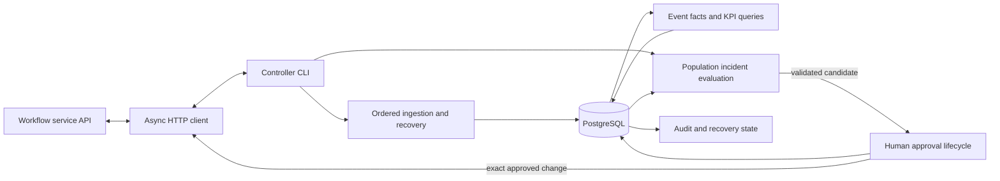

# Senda

### Make every interaction count.

Senda is an intelligent outbound operations platform direction: help teams
understand workflow outcomes, measure meaningful changes, evaluate
improvements with observed evidence, and keep sensitive configuration changes
reviewable. This repository contains a **simulator-backed controller
prototype**, not a hosted product or voice agent.

## The problem

Outbound operations teams need more than call volume or one blended score.
They need to see where outcomes change, understand which population and
configuration produced the result, and decide whether an intervention is
safe. If event processing loses its place after a crash or a timed-out write is
assumed successful, neither metrics nor change history are trustworthy.

Senda's product thesis is to connect observation, measurement, controlled
evaluation, human approval, safe application, and post-change evidence in one
traceable operating loop.

## How it works today

The current CLI reads a documented HTTP workflow contract. A bundled local
simulator provides that contract for development and tests; it is not the
Senda product boundary for a real integration.



The runtime is serial around ordered event checkpoints and analytics cursors.
It persists operation intent before remote writes and reconciles ambiguous
responses from documented remote state. Unresolved ambiguity stops for review.

## Current capabilities

- Ordered history/live event ingestion with bounded parsing, PostgreSQL
  persistence, checkpoints, and replay conflict detection.
- Restartable event-to-fact projection and separate KPI definitions:
  **pickup = connected / dials**; **engagement = concluded / connected**.
- Versioned cohort definitions, historical joins, quality classifications,
  and durable keyset-paginated audit queries.
- Deterministic, fixed-cutoff statistical evaluation with person-cluster
  resampling, Holm correction, separate guardrail evaluation, and persisted
  evidence. The runtime does not schedule experiments or allocate traffic.
- A narrow population prompt-incident workflow with credit checks, untrusted
  candidate validation, approval governance, safe apply, and post-change
  monitoring. No automatic rollback is implemented.
- Structured logs, bounded runtime telemetry, migration-managed PostgreSQL
  schema, and tested local recovery paths.

The [feature catalog](docs/product/FEATURE_CATALOG.md) distinguishes
implemented, partial, and absent capabilities. The project has no hosted UI,
user authentication, authorization model, tenant isolation, deployment stack,
backup service, alert routing, or customer support operation. It is not
production-ready as a SaaS product.

## Architecture and documentation

- [Documentation index](docs/README.md)
- [System overview](docs/architecture/SYSTEM_OVERVIEW.md)
- [Architecture and decisions](docs/architecture/ARCHITECTURE.md)
- [Data flows and diagrams](docs/architecture/DATA_FLOW.md)
- [Data model](docs/architecture/DATA_MODEL.md)
- [Governance](docs/architecture/GOVERNANCE.md)
- [Security](docs/architecture/SECURITY.md)
- [Reliability and recovery](docs/architecture/RELIABILITY.md) ·
  [recovery guide](docs/engineering/RECOVERY.md)
- [Production readiness](docs/architecture/PRODUCTION_READINESS.md)
- [Performance method and scoped evidence](docs/engineering/PERFORMANCE.md)
- [Product roadmap](docs/roadmap/PRODUCT_ROADMAP.md)

## Technology

- Python asyncio for the single-process controller lifecycle.
- HTTPX for pooled asynchronous HTTP with explicit timeouts and bounded GET
  retry behavior.
- PostgreSQL with SQLAlchemy async/asyncpg for durable state, constraints,
  transactions, and bounded bulk persistence.
- Alembic for versioned schema migrations.
- Pytest for unit, contract, and PostgreSQL integration tests; Ruff for lint
  and formatting checks.

The included simulator uses FastAPI/Uvicorn and scenario fixtures for local
development. This code is a harness, not a Senda call execution service.

## Repository structure

```text
controller/       runtime, HTTP client, ingestion, analytics, governance
  analytics/      facts, KPIs, cohorts, history and audit queries
  clients/        workflow-service HTTP boundary
  governance/     proposal, approval and apply reconciliation
  ingestion/      chunk parsing, persistence coordination and recovery
  storage/        PostgreSQL models, transactions and audit persistence
  statistics/     deterministic estimators
docs/             product, architecture, engineering, business, roadmap, brand
  launch/         unpublished communication drafts
migrations/       Alembic revisions
sim/              bundled local simulator harness
scenarios/        local simulator fixtures
tests/            unit, contract and PostgreSQL integration tests
scripts/          local measurement tooling
examples/         deliberately simplistic API sample; not the production runtime
```

## Quick start

### Prerequisites

Python 3.12 is the documented local setup. PostgreSQL 18 is needed to run the
controller and PostgreSQL integration tests. Docker Compose is optional and
starts only the local PostgreSQL service. A compatible workflow API is needed;
the bundled simulator can provide it for a local demonstration.

### Install and configure PostgreSQL

PowerShell:

```powershell
Copy-Item .env.example .env
# Edit .env and replace the local-only placeholder password.
py -3.12 -m venv .venv
.\.venv\Scripts\python.exe -m pip install -r requirements.txt
docker compose -f docker-compose.dev.yml up -d postgres
$env:CONTROLLER_DATABASE_URL = 'postgresql+asyncpg://<POSTGRES_USER>:<url-encoded-password>@127.0.0.1:5433/<POSTGRES_DB>'
.\.venv\Scripts\python.exe -m alembic -c alembic.ini upgrade head
```

Replace the placeholders with the `POSTGRES_USER` and `POSTGRES_DB` values in
your local `.env`, and URL-encode any reserved password characters. The
example values are local placeholders. The application reads
`CONTROLLER_DATABASE_URL` from its process environment; Python does not load
`.env`. Keep `.env` untracked and never use these example credentials outside
local development.

### Run the local harness and controller

In one terminal, start the local development fixture:

```powershell
.\.venv\Scripts\python.exe -m sim serve --scenario scenarios/public_01_dev.yaml --run-dir runs/local-demo
```

In a second terminal, set the same database URL and run:

```powershell
$env:CONTROLLER_DATABASE_URL = 'postgresql+asyncpg://<POSTGRES_USER>:<url-encoded-password>@127.0.0.1:5433/<POSTGRES_DB>'
.\.venv\Scripts\python.exe -m controller http://127.0.0.1:8700
```

The run directory is generated simulator state, is ignored by Git, and is not
read by Controller decision logic. To stop, use Ctrl+C; the controller
finishes the current in-flight operation boundary and closes resources.

The runtime applies checked-in Alembic migrations at startup. Settings for
advance interval, timeouts, connection bounds, GET retry, page/batch size, and
log level use validated `CONTROLLER_*` environment variables; defaults and
bounds are in [`controller/config/settings.py`](controller/config/settings.py).

## Tests and quality checks

Unit and contract tests:

```powershell
.\.venv\Scripts\python.exe -m pytest -q tests/unit tests/contract
```

For PostgreSQL integration tests, create a **separate disposable database**
and set `CONTROLLER_TEST_DATABASE_URL` to it. The fixture applies migrations
and deletes rows from Controller tables before each database test; never point
it at development or retained data.

```powershell
docker compose -f docker-compose.dev.yml exec postgres sh -c 'createdb -U "$POSTGRES_USER" senda_test'
$env:CONTROLLER_TEST_DATABASE_URL = 'postgresql+asyncpg://<POSTGRES_USER>:<url-encoded-password>@127.0.0.1:5433/senda_test'
.\.venv\Scripts\python.exe -m pytest -q tests/integration
.\.venv\Scripts\python.exe -m pytest -q
```

The last retained verification record reports **306 tests passed** against
isolated PostgreSQL; this documentation change did not rerun those tests. See
[testing strategy](docs/engineering/TESTING_STRATEGY.md) for the scope and
quality-check commands.

## Performance and maturity

The repository contains isolated persistence fixture comparisons for the
current COPY staging paths. They are not production throughput measurements.
The optimized full-workload runtime and any end-to-end target remain
unverified. See [performance evidence](docs/engineering/PERFORMANCE.md).

There is no license file in the repository; licensing has not been specified.
No support contact, product URL, or public service endpoint is established.
For security issues, do not send secrets or customer data through a public
issue; a security contact must be established before public release.
