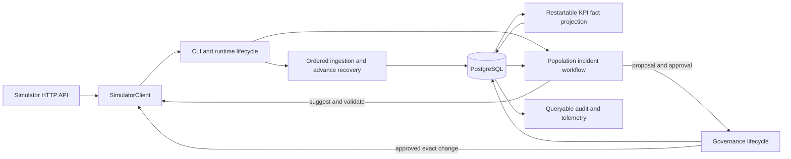

# Controller Architecture

The Controller is a Python asyncio command-line process. It observes the
simulator only through its documented HTTP API and stores durable state in
PostgreSQL. The simulator executes calls; this repository's Controller
ingests and evaluates observations, then uses the approval API before
customer-facing prompt changes.

## Runtime sequence

1. `controller/__main__.py` loads validated `CONTROLLER_*` settings, installs
   SIGINT/SIGTERM handlers, initializes the PostgreSQL store, applies Alembic
   migrations, and opens a bounded HTTPX client.
2. `controller/runtime/lifecycle.py` checks simulator health, workflows and
   current state, restores available history/live descriptors, reconciles
   pending advance intents, and projects event facts.
3. Before each live advance, the ingestion runner persists an outbox intent.
   It sends `/sim/advance` once, records returned descriptors, then ingests
   chunks in descriptor order. Each chunk's events and checkpoint commit
   atomically. Ambiguous advances are reconciled from simulator state and
   ordered descriptors; unresolved ambiguity stops the run.
4. `KpiFactProcessor` reads bounded pages and derives one persisted fact per
   source event. Facts and their analytics cursor are committed together.
5. After startup and each committed advance, the runtime calls
   `process_population_incidents()`. When public evidence meets its gates, the
   incident workflow checks credits, requests untrusted candidate prompts,
   validates them, and submits proposals through the approval lifecycle.
6. The governance lifecycle records a stable proposal and outbox intent before
   POST, reconciles approvals, verifies current config version, persists apply
   intent, and applies only the exact approved proposal. Ambiguous results are
   reconciled through documented reads or left for manual review.
7. On completion or a requested stop, the runtime emits final metrics and
   closes the HTTP client and database pool.

## Modules

| Area | Responsibility |
|---|---|
| `controller/__main__.py` | CLI entry point, startup/shutdown and signals |
| `controller/config/` | Validated runtime settings and URL checks |
| `controller/clients/simulator.py` | Documented HTTP API methods, bounded GET retry, streaming, typed errors and response validation |
| `controller/runtime/` | Readiness, serial advance loop, fact/incident hooks, heartbeat and final metrics |
| `controller/ingestion/` | Chunk descriptors, NDJSON parsing, order, persistence and ambiguous advance reconciliation |
| `controller/storage/` | SQLAlchemy models, transactions, COPY persistence, checkpoints, outbox and audit records |
| `controller/analytics/` | Fact projection, separate KPIs, historical joins, cohort definitions and audit queries |
| `controller/statistics/`, `controller/experiments.py` | Deterministic person-cluster estimation, evidence evaluation and governed proposal creation; not automatically scheduled |
| `controller/governance/` | Proposal validation, state transitions, approval/apply reconciliation and safe halt |
| `controller/incidents.py` | Population QA evidence, credit-aware suggestion/validation, governed prompt changes and post-apply monitoring |
| `controller/telemetry.py`, `controller/observability/` | Bounded runtime metrics and structured JSON logs |
| `migrations/` | Versioned PostgreSQL schema changes through Alembic |

## Persistence and recovery

`simulator_events.event_id` is the durable event uniqueness key. Streaming event
batches are copied to a temporary staging table and merged using
`INSERT ... SELECT ... ON CONFLICT`; a conflict triggers bounded comparison of
the saved chunk, kind and JSONB payload. The chunk descriptor checkpoint is
committed in the same transaction. Event reads may replay; conflicting content
is an error.

KPI fact batches use the same temporary COPY-stage/set-based-merge pattern,
conflicting on the unique source event. Workflow references, facts and the
analytics cursor update commit together. The database retains the event and
fact indexes/foreign keys needed for query paths and provenance; migration 0009
removed only the measured-unused event `(kind, chunk_number)` index.

`outbox_operations` stores remote operation intent/state. It cannot make a
simulator HTTP call atomic with PostgreSQL. Recovery therefore uses documented
remote state, approval lookup and config history. Exactly-once remote delivery
is not guaranteed; when evidence is insufficient, the Controller stops and
requires review rather than blindly retrying.

## Technology choices

- **Python 3.12 + asyncio:** one maintainable process can overlap bounded HTTP
  reads without introducing workers or a broker. Ordered event/checkpoint and
  fact-cursor writes remain serial.
- **HTTPX:** pooled async requests, explicit timeouts, bounded connections,
  streaming responses and injectable test transports.
- **PostgreSQL + SQLAlchemy async/asyncpg:** durable indexed relational state,
  constraints, transactions and direct PostgreSQL COPY for large bounded
  batches.
- **Alembic:** explicit, reversible schema history; startup applies migrations
  through the same configured database URL.
- **JSON logs and bounded in-process telemetry:** operational visibility
  without a new metrics server or mandatory monitoring infrastructure.
- **No broker, Redis or worker fleet:** no measured need offsets their
  operational and recovery complexity in the selected single-process scope.

## Boundaries and limitations

- `sim/` and `runs/` are assignment/simulator assets. Controller decisions do
  not read them; runtime interaction is HTTP-only.
- Experiment plans require explicit baseline, allocation, cluster, power and
  guardrail assumptions. The runtime does not schedule experiments
  automatically.
- Decay detection/rollback, caller-ID health, call-time optimization, a
  supervisor UI, approver-aware batching, and cross-tenant credit scheduling
  are not implemented.
- The runtime has no HTTP health/metrics server. It emits logs and metrics
  records for a surrounding process supervisor/collector.
- The full public_03 target below 50 minutes remains unverified after the
  persistence changes; isolated microbenchmarks are not full-load evidence.

