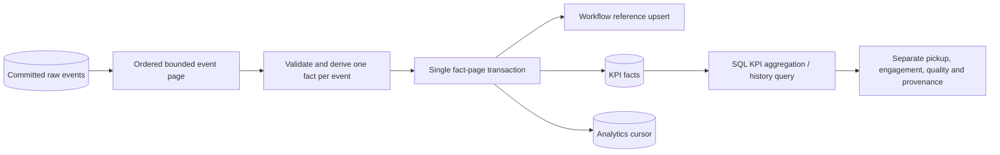
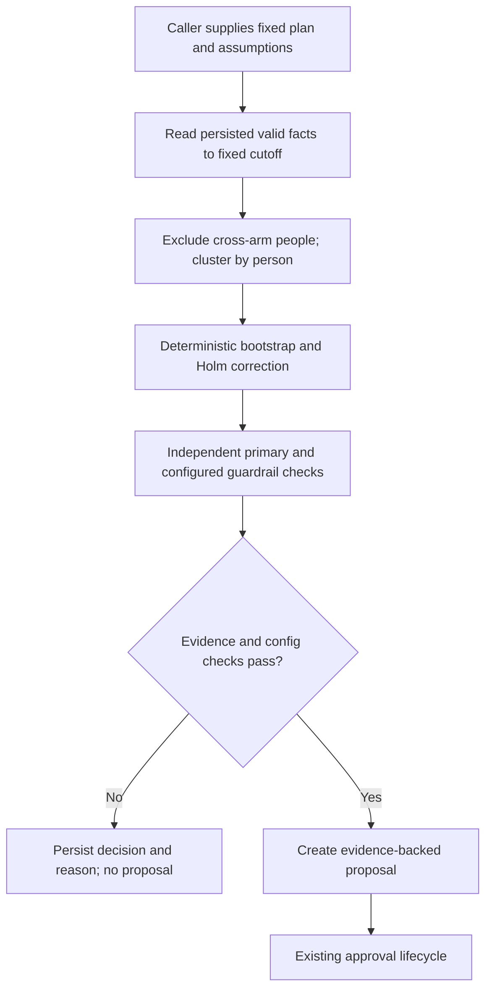
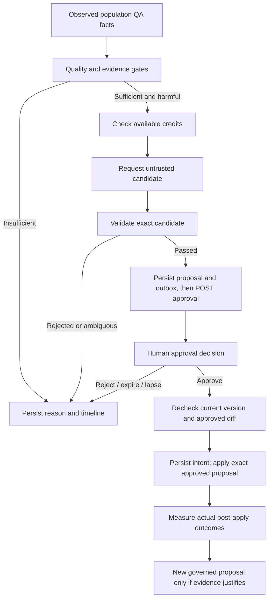
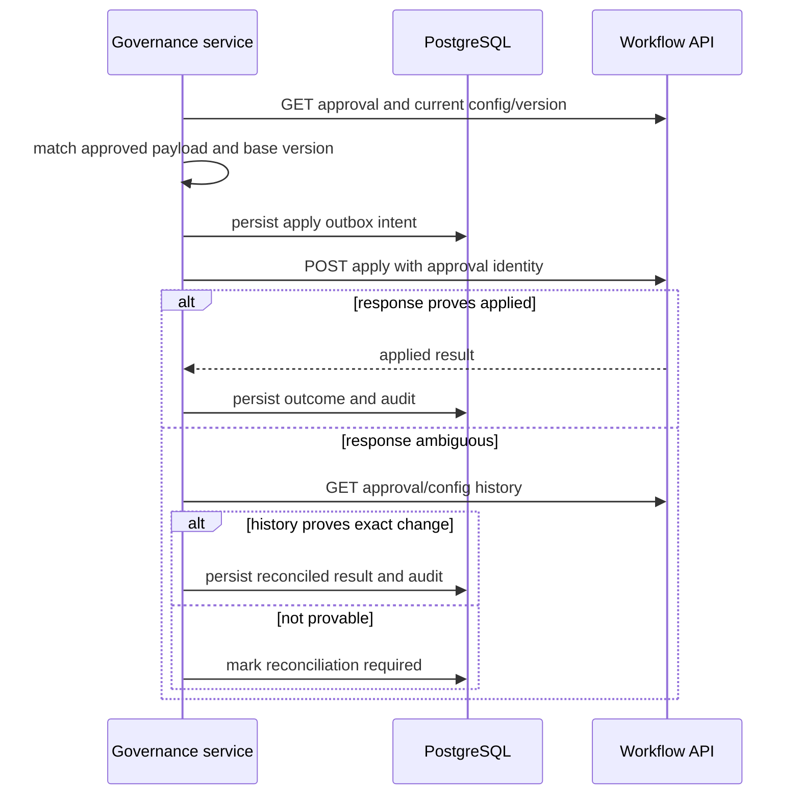
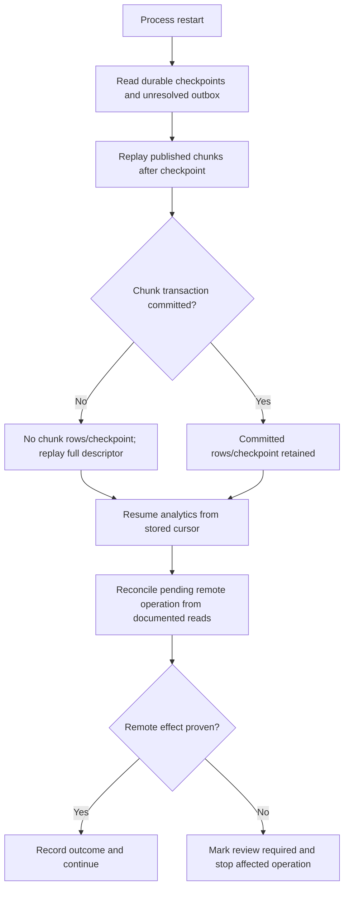
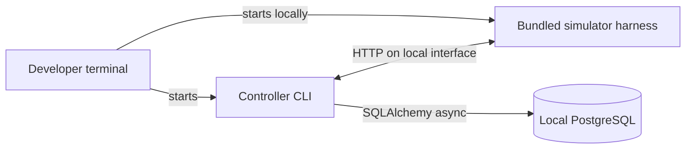

# Data and decision flows

These diagrams represent the current controller implementation and local
integration topology. They do not depict a hosted deployment.

## Event ingestion

```mermaid
sequenceDiagram
    participant Runtime
    participant Client as HTTP client
    participant API as Workflow API
    participant Store as PostgreSQL store
    Runtime->>Client: health, workflows, state
    Runtime->>Store: read checkpoint
    Runtime->>Client: list history/live chunks after checkpoint
    Client->>API: GET chunk descriptors
    Runtime->>Client: stream descriptor NDJSON
    Client->>API: GET chunk body
    Runtime->>Runtime: validate IDs, ordering, count and bounds
    Runtime->>Store: begin transaction
    Store->>Store: COPY to temp stage; merge; check replay conflicts
    Store->>Store: write checkpoint in same transaction
    Store-->>Runtime: commit result
```

## Analytics



Pickup is connected/dials; engagement is concluded/connected. Invalid,
incomplete, and unsupported facts remain classified and are excluded from
valid evidence as appropriate.

## Experiment evaluation



The runtime does not schedule experiment plans or assign traffic. Statistical
evaluation is deterministic code, not an LLM decision.

## Incident and approval lifecycle



## Safe apply



## Recovery



## Local development topology



There is no controller container, broker, worker fleet, metrics server, or
production deployment topology defined in this repository.
