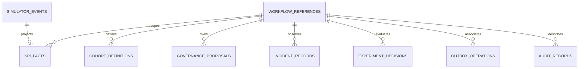

# Persistence model

Alembic manages a PostgreSQL schema represented by SQLAlchemy models in
`controller/storage/models.py`. This is the controller's operational store,
not a customer-facing warehouse or an immutable external event ledger.

## Core tables

| Table | Purpose | Key relationships and constraints |
|---|---|---|
| `simulator_events` | Raw event envelope keyed by global source event ID | Unique primary key; chunk index |
| `processing_checkpoints` | Last fully committed descriptor for a named stream | Keyed by checkpoint name; updated with event transaction |
| `kpi_facts` | One quality-classified projection per source event | FK to `simulator_events`; optional FK to workflow; additive count checks; KPI query indexes |
| `analytics_checkpoints` | Last source event scanned by a processor | Processor key; updated with the corresponding fact page |
| `workflow_references` | Workflow IDs observed by the controller | Parent reference used by related records |
| `cohort_definitions` | Ordered immutable predicates for a workflow config version | Composite identity; FK to workflow reference |
| `governance_proposals` | Stable proposal payload, base version, remote status and outcome | FK to workflow; unique approval ID; checked lifecycle status |
| `outbox_operations` | Durable intents for remote operations and reconciliation | Stable unique dedupe key; optional workflow FK; checked operation status |
| `incident_records` | Incident evidence, current phase and timeline | Unique workflow/trigger-config pair; FK to workflow |
| `experiment_decisions` | Reproducible fixed-cutoff statistical snapshot and decision | Unique workflow/experiment and workflow/config family; FK to workflow |
| `audit_records` | Actor, action, reason, resource, evidence and occurrence time | Optional workflow FK; indexes support bounded queries |
| `controller_runs` | Process-attempt lifecycle details | Independent UUID and status constraint |

## Relationships

## Transaction units

- One event descriptor's event rows and `processing_checkpoints` value are
  atomic.
- One KPI page's workflow references, fact merge, and analytics cursor update
  are atomic.
- A governance/incident state transition and its associated audit entry share
  a transaction where implemented.
- Remote HTTP effects cannot participate in these local transactions. The
  outbox records intent and later reconciliation evidence, not distributed
  atomicity.

The exact revision history is under `migrations/versions/`. Migration checks
and isolated PostgreSQL verification are reported in
[`ENGINEERING_VERIFICATION.md`](../engineering/ENGINEERING_VERIFICATION.md).
