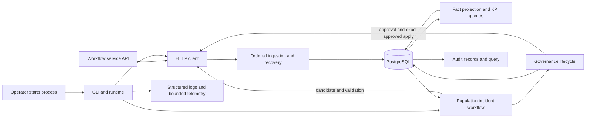

# Senda system overview

The current Senda prototype is an asynchronous Python command-line process
that observes an external workflow service over HTTP and persists controller
state in PostgreSQL. A local simulator in this repository supplies the
development/test API contract; the controller itself does not place calls or
run a voice agent.

## Boundaries

- The API service owns call execution, workflow configuration, approvals, and
  remote state.
- The controller owns durable copies of observed events, derived facts,
  checkpoints, proposals, local operation intents, incident evidence, and
  audit records.
- PostgreSQL is the durable local system of record for controller-side
  processing and recovery.
- The controller's runtime advances one workflow-service clock serially. It
  does not parallelize ordered checkpoint or analytics-cursor writes.
- The bundled simulator is a local harness, not a Senda production service.

## Maturity

The repository demonstrates a durable controller and integration patterns.
It does not contain a hosted control plane, user interface, production
identity system, tenant isolation, or deployment/alerting stack. See the
[readiness assessment](PRODUCTION_READINESS.md).
