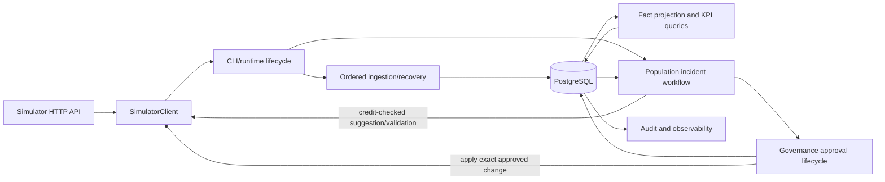

# Formi Outcome-First Agent Loop — Final Submission Report

**Review date:** 2026-11-09  
**Implementation:** Python 3.12, asyncio, HTTPX, SQLAlchemy async/asyncpg, PostgreSQL 18, Alembic  
**Repository branch at review:** `main`

## 1. Project overview and problem

The Controller observes outbound voice-agent workflows through the documented
simulator HTTP API. It durably ingests call and configuration events, derives
separate pickup and engagement facts, evaluates population evidence, and
records why an incident or proposed change was considered. The simulator runs
calls; the Controller does not implement or modify the voice agent.

The assignment concerns safely improving workflow outcomes while keeping
human governance, customer/compliance constraints, auditability, and restart
safety. No scenario truth is used as a decision input.

## 2. Architecture summary

The runtime is a single asynchronous CLI process. `controller/clients/` owns
HTTP contracts; `controller/ingestion/` owns ordered event delivery and
advance recovery; `controller/storage/` owns database and audit writes;
`controller/analytics/` owns facts/KPIs/history; `controller/governance/`
owns proposal/approval/apply reconciliation; and `controller/incidents.py`
orchestrates the population incident workflow. Component boundaries and the
step-by-step flow are in `docs/ARCHITECTURE.md`.

## 3. Main capabilities and engineering decisions

### Event ingestion and recovery

At startup, the Controller checks simulator readiness, discovers history and
live chunk descriptors, and ingests chunks in global descriptor order. NDJSON
is parsed and validated in bounded batches. Event IDs are unique; exact
replays are idempotent and different content for a stored ID is rejected.
Chunk events and the descriptor checkpoint commit atomically. Before
`/sim/advance`, the Controller stores an outbox intent; ambiguous outcomes are
reconciled from documented state and chunk listings. This provides effectively
once local effects under replay, not exactly-once remote execution.

The real process-kill/restart evidence is in `reports/crash_recovery.md`. It
records rollback of a partial chunk transaction and recovery of a pending
approval with the same PostgreSQL database and simulator state.

### Persistence and data model

Alembic migrations `0001`–`0009` manage the PostgreSQL schema. Principal tables:

- `simulator_events`: raw event payload, global event ID, chunk and kind.
- `processing_checkpoints`: committed event-chunk progress.
- `kpi_facts`: validated additive counts and provenance per event, including
  workflow, person, config, cohort, variant and QA fields.
- `analytics_checkpoints`: durable fact-projection cursor.
- `workflow_references` and `cohort_definitions`: workflow metadata and
  immutable config-versioned cohort rules.
- `governance_proposals`, `outbox_operations`, and `incident_records`:
  proposal/remote-operation state and incident evidence/timeline.
- `experiment_decisions`: frozen input snapshots, policy, metrics and outcome.
- `audit_records`: durable actor, action, reason, resource and evidence.
- `controller_runs`: run lifecycle and details.

KPI facts and their analytics cursor share a transaction. Events and chunk
checkpoint share a transaction. Current bulk paths use PostgreSQL COPY into
transaction-local temporary staging tables followed by set-based
`INSERT ... SELECT ... ON CONFLICT`; existing uniqueness, foreign keys,
conflict validation and transaction boundaries are preserved.

### KPI methodology

Pickup is **connected / dials**. Engagement is **concluded / connected**.
Business outcome (where reported) is **concluded leads / uploaded leads**.
These are independent quantities; no blended rate is computed. A zero
denominator yields an undefined rate. Facts classify incomplete, invalid and
unsupported records so they do not silently count as valid evidence.

The deterministic experiment evaluator uses person-cluster bootstrap, Holm
correction and a fixed window/event cutoff. It requires explicit baselines,
allocation, clustering, power and guardrail inputs. The 5-percentage-point
MDE is a configurable engineering starting point, not a business target. Since
simulator assignment is per dial and does not guarantee person-stable arms,
people observed in multiple arms are excluded. Experiment plans are not
automatically scheduled by the runtime.

### Governance and incident workflow

Proposal identity, payload and outbox intent are committed before
`POST /approvals`. Approval state is polled/reconciled. Before apply, the
Controller rechecks approval and config version, stores apply intent, and uses
the approved proposal ID. Ambiguous apply results are checked against
documented config history; unresolved ambiguity stops for manual review.

After startup and each committed advance, runtime incident processing checks
documented supervisor prompt changes against valid population QA evidence. It
checks credits before paid suggestions, treats LLM output as untrusted,
validates a candidate with the simulator API, and routes a matching prompt
change through the approval lifecycle. Post-apply outcomes are monitored; a
correction, if justified, is a new governed proposal. There is no direct config
write or automatic rollback path.

## 4. Security, audit and observability

Controller decisions use simulator HTTP responses and persisted Controller
records. Controller source does not import simulator implementation modules,
read scenario YAML, or read `runs/`. Structured logging allowlists context and
does not log request bodies or database parameters. URL validation rejects
embedded simulator credentials. `.gitignore` excludes `.env`, local databases,
virtualenv and run directories; `.env.example` contains placeholders only.

The simulator contract does not document authentication, so real-service
authentication and TLS deployment policy are unverified. The secret scan was a
limited repository/history pattern check, not a penetration test.

Runtime output includes structured heartbeats and final bounded metrics:
ingestion progress/lag, API status/latency, event/fact throughput, database
size, RSS when available, credits where supplied, and separate rates. There is
no HTTP metrics server or alert delivery integration. Audit browsing is
durable, read-only and keyset-paginated.

## 5. Scenario and performance results

- **`public_01_dev`:** completed at 11,520 simulated minutes with 297,024
  events. The actual grader report (`reports/public_01.md`) shows zero changes
  and 0.0% KPI delta. No experiment plan was automatically scheduled.
- **`public_02_incidents`:** completed at 14,400 simulated minutes. The grader
  reports one controller-approved prompt change, rated beneficial. The
  incident report records config version 2 to 3, one suggestion and one
  validation, and four credits used. The final post-apply QA/engagement gate
  was insufficient; no corrective proposal was made.
- **Historical full `public_03_load`:** 7,200 simulated minutes in 5,878.203
  seconds (97.97 minutes), 9,737,439 events/facts, 1,656.962 events/second.
  Its `<600 wall seconds per simulated day` SRE criterion failed at 1,175.641
  seconds/day. The original worker CPU/RSS values are invalid because the
  sampler measured the Windows launcher shim.
- **Later 720-minute profile:** 3,697.404 seconds and 5,891,391 total events
  after history ingestion. This is about 60.5% of full event work and is not a
  10%-of-events profile. It predates the COPY persistence changes.
- **Isolated 1,000-row/page fixtures:** KPI COPY staging reduced median page
  time from 356.699 ms (281.374 ms SQL, 2.357 ms commit) to 47.685 ms (about
  5.7 ms COPY, 26.049 ms merge, 2.447 ms commit). Event COPY staging reduced
  median chunk time from 74.300 ms (58.068 ms event SQL, about 1.178 ms commit)
  to 23.658 ms (about 10.1 ms COPY+merge, about 2.1 ms commit). These local
  fixtures show a persistence-path improvement only; they do not predict
  end-to-end public workload runtime.

The complete chronology and exact caveats are in `reports/FINAL_PERFORMANCE_REPORT.md`
and `reports/PERFORMANCE_OPTIMIZATION_RECOMMENDATIONS.md`.

**The 50-minute full-workload target remains unverified because the full
benchmark was not rerun after optimization.**

## 6. Verification

On isolated PostgreSQL database `formi_perf_verify_20261109`:

- `pytest -q tests/unit tests/contract`: **214 passed**.
- `CONTROLLER_TEST_DATABASE_URL=<isolated DB> python -m pytest -q tests/integration`:
  **92 passed**.
- Full `pytest -q`: **306 passed**.
- Alembic downgrade from `0009` to `0008`, upgrade back to head, and
  `alembic check`: passed with no schema drift.
- `ruff check .`, `ruff format --check .`, compileall and
  `git diff --check`: passed.

No full/partial load test, stress test, large benchmark, simulator API write,
or hidden scenario access was performed during final audit. The retained
benchmark database and evidence were not modified.

## 7. Scope limits and known weaknesses

- Automatic C7 decay detection/rollback, caller-ID health, per-person call-time
  optimization, supervisor UI, approver-aware batching, and cross-tenant credit
  scheduling are out of scope.
- Experiments are deterministic and governed but require a caller-supplied
  fixed plan; runtime traffic assignment/scheduling is not implemented.
- Approval lifecycle is safe but does not implement approver-hours/fatigue
  batching or policy-permitted auto-apply.
- Full public workload throughput, current-worker CPU/RSS on the grading host,
  query-specific PostgreSQL waits and production authentication are unverified.
- Dependency ranges are lower bounds rather than a lock file.

Requirement status by capability and evidence is in
`reports/REQUIREMENT_IMPLEMENTATION_AUDIT.md`; security findings are in
`reports/SECURITY_GOVERNANCE_AUDIT.md`.

## 8. Repository and how to run

The project layout, startup sequence, persistence boundaries and recovery path
are in `docs/ARCHITECTURE.md`. Developer prerequisites and commands are in
`README.md`. In brief: install `requirements.txt`, configure a PostgreSQL URL,
start a permitted simulator separately, then run `./run.sh <SIM_URL>` (or
`python -m controller <SIM_URL>`). The Controller applies Alembic migrations
at startup. PostgreSQL integration tests must point to a disposable database
because the fixture clears Controller table rows.

## 9. Final conclusion

The repository implements durable HTTP-only ingestion, separate KPI facts,
statistical evaluation, governed approval/apply, population incident response,
crash recovery, audit and operational telemetry. The latest persistence
changes are supported by isolated PostgreSQL comparisons and a passing
306-test suite. The results justify retaining the COPY staging design, but they
do not establish a 50-minute full-run result. That performance claim remains
explicitly open pending a separately authorized full public benchmark.

